<div align="center">

# tap-on-shoulder

### Your agents keep working. We tap you when you're needed.

When a Claude Code session has been waiting for **you** for 5 minutes, you get **one** notification on your phone. It tells you which project is waiting and what it needs from you. Sessions that are still working never notify.



<sub>▶ Placeholder animation. A real side-by-side recording (terminal + phone) is coming soon.</sub>

</div>

> [!NOTE]
> **Alpha.** It works end to end and is tested against real Claude Code sessions (2.1.310). The classifier is a **preview**: it is trained on synthetic data and tuned so that it doesn't miss questions. Linux and macOS only. See [what's verified](docs/design/verified-interfaces.md).

## Install

Inside Claude Code:

```text
/plugin marketplace add karimQuant/tap-on-shoulder
/plugin install tap-on-shoulder@tap-on-shoulder
/tap-on-shoulder:setup
```

`setup` prints your private ntfy topic. Subscribe to it in the [ntfy](https://ntfy.sh) app, then run `/tap-on-shoulder:test` to get your first tap. The plugin downloads its small verified binary in the background on first use. [Full guide →](docs/getting-started.md)

## The result

You leave three sessions running and go get coffee. Here is what reaches your phone:

| What happens in the session | What you get |
|---|---|
| `payments-service` asks *"keep the legacy column or drop it?"* | **One tap after 5 min:** *payments-service · waiting 5m · needs a decision* |
| `web-app` runs a 20-minute test suite with no output | Nothing. It's working. |
| `infra` stops for a permission prompt | One tap once its permission grace period runs out (configurable) |
| You reply to `payments-service` after 3 minutes | Nothing. The pending tap is cancelled. |
| A task finishes with *"All tests pass."* | Nothing, unless you turn on completion alerts |

With Claude Code's built-in Remote Control (`/rc`) turned on, you also get Claude's own immediate push. tap-on-shoulder is the follow-up that arrives only if the session is **still** stuck.

## Why

Long-running agents create a new kind of waiting. Claude asks a question 30 seconds after you walk away, and the session sits idle for the next 40 minutes. Checking every terminal doesn't scale. Alerting after every response trains you to ignore alerts.

tap-on-shoulder alerts only on **continuous waiting** and tells you **what's needed**. It sends **once** per waiting episode.

## Security at a glance

- 🔒 **Runs locally.** Classification uses a small embedded model (model2vec, about 8 MB, under 5 ms on a CPU). No cloud LLM and no hosted backend.
- 📤 **Sends one thing:** a short, redacted notification (project, wait time, what's needed) to *your* ntfy topic. No telemetry.
- 🙈 **Never reads your code** or transcript files. It sees only the hook data Claude Code gives plugins.
- ✋ **Never acts.** It cannot approve permissions, type into a session, or resume a task. It only watches.
- 🧪 **Prompt-injection aware.** Session text is treated as untrusted data and is classified into a fixed set of labels, never executed.

Read the full [security model →](docs/security.md)

## Documentation

| | |
|---|---|
| 🚀 [Getting started](docs/getting-started.md) | Install, set up ntfy, send a test tap |
| ⚙️ [Configuration](docs/configuration.md) | Grace periods, completion alerts, privacy modes |
| 🧭 [How it works](docs/how-it-works.md) | Waiting episodes, session states, the classifier |
| 🔐 [Security & privacy](docs/security.md) | What it reads, stores, sends, and never does |
| ❓ [FAQ](docs/faq.md) | False alarms, multiple sessions, built-in notifications |
| 🗺️ [Roadmap](docs/roadmap.md) | What's planned, what's not |
| 🏗️ [Design notes](docs/design/README.md) | Research, verified Claude Code interfaces, open questions |

## Contributing

This project is in alpha, which is the best time to influence it. The most useful help right now is real-world testing: run it in your own sessions and report missed or unwanted taps. The classifier is trained on synthetic data only, so labelled real endings help most. Turn on `training.collect = true` in your user config, then label what was collected with `tap label` (the data stays on your machine; share only what you choose). Ideas, critiques, and "Claude was waiting and I missed it" stories are welcome too. See [CONTRIBUTING.md](CONTRIBUTING.md). To report a security issue, see [SECURITY.md](SECURITY.md).

## License

To be decided before the first release.
