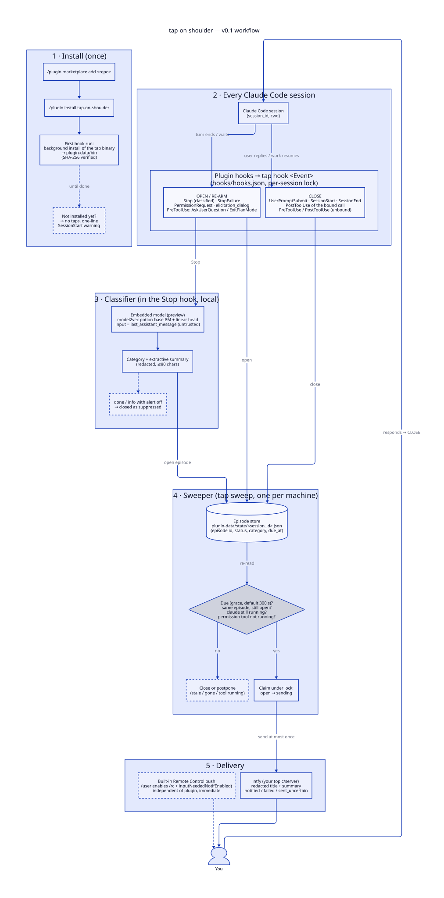

# How it works

> [!NOTE]
> This page describes the **proposed** design. The Claude Code interfaces it relies on are listed, with links to the official docs, in [Verified interfaces](design/verified-interfaces.md).

Source: [`assets/workflow.d2`](assets/workflow.d2). Re-render with `d2 --layout elk workflow.d2 workflow.svg`.

## The idea in one sentence

A **waiting episode** opens when a session stops and needs you. If it is still open after the grace period, you get **exactly one** notification for it.

## 1. Hooks record events

Claude Code runs the plugin's hooks on session events.

| Opens an episode | Closes an episode |
|---|---|
| `Stop`: Claude finished its turn | `UserPromptSubmit`: you replied |
| `StopFailure`: the turn ended with an API error | `PreToolUse`: work resumed, e.g. after you approved a permission |
| `Notification` (`permission_prompt`, `elicitation_dialog`) | `SessionStart` / `SessionEnd` |

If a `Stop` arrives while background tasks are still running, it doesn't open an episode. The session is still **working**.

## 2. One sweeper for all sessions

When an episode opens, the hook writes a small state file and makes sure a single background process, `tap sweep`, is running. It is not a daemon: it exits as soon as nothing is waiting. Every few seconds it checks each open episode against four conditions:

- Is the grace period over?
- Is the episode still open? Any reply or new activity closes it, and a newer turn replaces it.
- Is the Claude Code process for that session still running?
- For a permission prompt: is it still unanswered? If the approved tool is already running, the tap is postponed.

It sends only when all four hold, and it sends **at most once** per episode.

## 3. Local classification

| State | Example | Tap by default? |
|---|---|---|
| `working` | Long build, background task still running | Never |
| `needs_decision` | "Which migration strategy do you want?" | Yes |
| `needs_permission` | Permission prompt waiting for approval | Yes |
| `blocked` | API error, missing credentials | Yes |
| `done` | "All tests pass, PR ready." | Only with `alerts.completion` |
| `info` | "Let me know if you'd like anything else." | No |
| `unknown` | Missing or contradictory events | Logged and shown in `tap doctor`. Never treated as idle |

- **Event rules decide first.** A permission prompt means `needs_permission`. An API error means `blocked`. Claude asking through its question tool means `needs_decision`.
- **The embedded model handles the rest.** When the rules can't decide, the plugin reads Claude's final message with a small model (model2vec static embeddings plus a linear head, about 30 MB). It runs on your CPU in milliseconds.
- **The model only labels.** It is not generative, so all it can do is pick one of the labels above.
- **The summary is copied, not written.** It is the last question or error line from the message, redacted and cut to 80 characters.

Classification runs as soon as the episode opens, because that is when its grace period gets chosen. Questions, permissions, and blocked states each have their own grace period.

## 4. One notification

The plugin sends one notification to your ntfy topic: project folder name, wait time, category, and the summary. It then marks the episode as notified, so a restart can't send it again.

## Sessions, subagents, background work

- **Sessions:** each Claude Code session is tracked by its `session_id`, so concurrent sessions alert independently.
- **Subagents and background tasks:** these count as the parent session still **working**. They don't trigger alerts of their own.

## When something fails

| Failure | Behaviour |
|---|---|
| Binary missing or unverified | A one-line warning at session start, plus a log entry. No taps until the background install succeeds |
| Embedded model fails to load | Rules-only classification, logged |
| Classifier unsure | `lean = "alert"`: tap rather than stay silent |
| ntfy unreachable | Limited retries, then logged and shown in `tap doctor`. Never counted as delivered |
| Machine slept or restarted | Wall-clock check on the next hook. The `notified` flag prevents duplicates |
